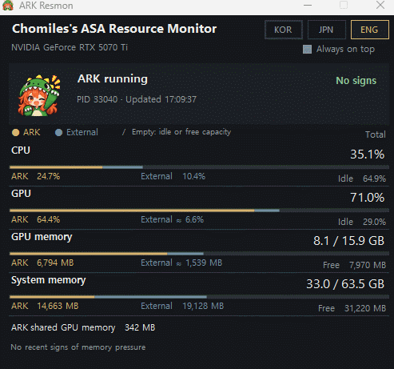

# ArkSA ResMon

[English](README.md) · [한국어](README.ko.md) · [日本語](README.ja.md)

Windows용 **ARK: Survival Ascended(ASA) 리소스 모니터**입니다.

ARK: Survival Ascended를 여유 있게 즐기려면 **VRAM 12GB 이상의 그래픽카드를 권장합니다**. 8GB급 그래픽카드에서도 구동할 수 있지만, 그래픽 옵션을 적절히 조절하고 백그라운드 프로그램의 점유량을 고려해 게임이 사용할 VRAM을 충분히 확보해야 합니다. 실제 필요 용량은 설정과 화면에 표시되는 환경에 따라 달라집니다.

모드, 코스메틱, 대규모 기지나 메가 트라이브 환경에서는 VRAM 사용량이 크게 증가할 수 있습니다. 전용 VRAM이 부족해 GPU 메모리 데이터가 시스템 RAM으로 이동하는 상황이 발생하면, GPU 코어 사용률이 높지 않더라도 프레임이 떨어질 수 있습니다.

**ArkSA ResMon은 CPU·RAM·GPU·VRAM 사용량을 시각화하고, 측정 가능한 범위에서 ARK와 다른 프로그램의 점유량을 구분해 보여주는 도구입니다.** 백그라운드 작업이 차지하는 자원과 게임 실행 중 메모리 압박 징후를 한눈에 확인할 수 있습니다.

메모리 상태는 사용량의 변화 추세에 따른 추정입니다. 실제 페이징 이벤트나 프레임 수를 직접 측정하지는 않습니다.

## 다운로드 및 실행

1. [ARK_Resmon.exe](dist/ARK_Resmon.exe) 페이지에서 **Download raw file** 버튼으로 내려받거나, 릴리스에 EXE가 첨부되어 있다면 해당 파일을 사용하세요.
2. 더블클릭하면 실행됩니다. 설치나 Python, 별도 GIF 파일은 필요하지 않습니다.
3. ARK: Survival Ascended를 실행하면 자동 연결됩니다. 게임을 다시 실행해도 연결을 다시 찾습니다.

우측 상단 **KOR / JPN / ENG**로 언어를 변경합니다. 매번 실행할 때 기본 언어는 **영어**입니다. **항상 위에** 옵션으로 창을 유지할 수 있으며, 창을 닫거나 **Esc**를 누르면 종료됩니다.

## 지원 환경

- Windows 10/11 x64, .NET Framework, Windows PowerShell 5.1.
- GPU 측정은 Windows GPU 성능 카운터와 NVIDIA 드라이버의 `nvidia-smi`를 사용합니다. 다른 제조사 GPU의 지원은 제한됩니다.
- 필요한 측정값을 읽지 못하면 해당 항목을 **측정 불가**로 표시합니다.

## 화면 읽기

- **금색:** ARK 사용량. **회청색:** 다른 프로그램의 사용량. 빈 구간은 유휴 자원 또는 남은 메모리입니다.
- CPU/GPU 백분율은 전체 장치 기준입니다. ARK의 시스템 RAM은 프로세스 Working Set입니다.
- **≈**가 붙은 GPU·VRAM 외부 값은 전체에서 ARK 사용량을 뺀 추정치입니다. 공유 메모리와 측정원·시점 차이로 오차가 발생할 수 있습니다.
- 큰 메모리 숫자는 GiB를 `GB`로, 세부 숫자는 MiB를 `MB`로 표시합니다.
- 메모리 상태는 **대기 / 측정 준비 / 징후 없음 / 메모리 압박 / 스왑 의심 / 측정 불가**입니다. 공유 GPU 메모리 사용만으로 스왑을 확정하지 않습니다.

소스 구성, 빌드 및 검증 명령은 [영문 README](README.md#source-and-build)를 참고하세요.
